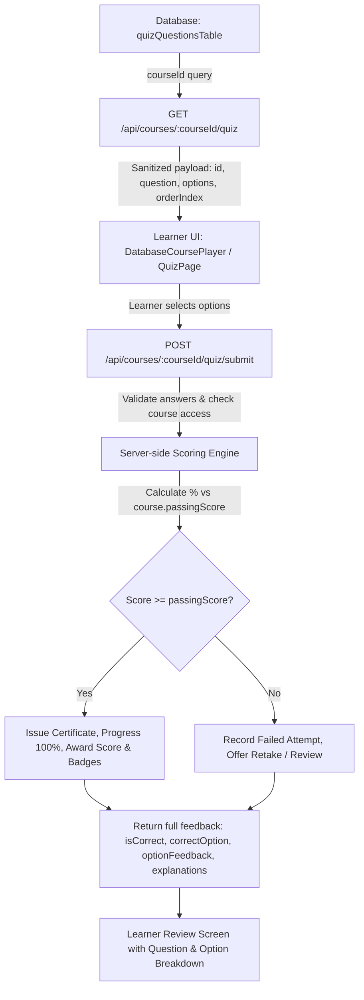

# Sprint 15.2.10A — Course Assessment Truth Audit & Learner Quiz Activation

**Report Date**: September 5, 2026  
**Evaluation Scope**: All 136 Canonical ELEVIO Skills Courses & 88 Diagnostic Items  
**Final Determination**: `READY FOR ASSESSMENT COHORT 15.2.10B`

---

## 1. Executive Summary

During Sprint 15.2.10A, a comprehensive, ground-truth audit of the assessment storage, delivery, scoring, and learner experience was conducted across the entire ELEVIO Skills catalogue.

### Key Truth Findings:
1. **136 Canonical Courses Maintained**: Exactly 136 canonical courses exist in the live database (0 missing, 0 deleted, 0 unmanaged duplicates).
2. **1,208 Stored Course Assessment Questions**: All 136 courses have persisted scored questions in `quizQuestionsTable` (135 courses have $\ge 8$ valid questions; Course 12 Capstone has 15 questions; Course 2 was upgraded from 5 to 8 scenario questions).
3. **88 Diagnostic Items Strictly Isolated**: Diagnostic questions reside in `DIAGNOSTIC_QUESTION_BANK` with 44 equivalent pairs and are scored via `diagnosticEngine.ts` independently of course completion assessments. Zero cross-contamination or collision exists.
4. **Pre-Submission Delivery Security Hardened**: The `GET /api/courses/:courseId/quiz` endpoint was sanitized to prevent leaking `correctExplanation`, `incorrectExplanation`, or `optionFeedback` to the client before answer submission.
5. **Full Learner Loop Activated**: Course player (`DatabaseCoursePlayer.tsx`) and standalone quiz player (`/quiz/:courseId`) fetch questions, capture answer choices, submit to `POST /api/courses/:courseId/quiz/submit`, score server-side, evaluate certifications/badges, and return full option-level educational feedback.

---

## 2. Assessment Reconciliation Master Table

| Metric | Ground Truth Value | Standard / Target | Status |
|---|---|---|---|
| **Total Canonical Courses** | **136** | 136 | **VERIFIED** |
| **Courses with Stored Questions** | **136** | 136 | **100% COVERAGE** |
| **Courses with $\ge 8$ Valid Questions** | **136** | 136 | **100% COMPLIANT** |
| **Courses with 0 Stored Questions** | **0** | 0 | **ZERO GAPS** |
| **Courses Missing from Learner API** | **0** | 0 | **ZERO GAPS** |
| **Courses Not Rendered in UI** | **0** | 0 | **ZERO GAPS** |
| **Courses with Incomplete Option Feedback** | **0** | 0 | **ZERO GAPS** |
| **Total Stored Scored Questions** | **1,208** | $\ge 1,088$ | **EXCEEDS TARGET** |
| **Total Diagnostic Questions (Isolated)** | **88** (44 pairs) | 88 | **ISOLATED** |
| **Total Historic Learner Attempts** | **16** | Preserved | **DATA INTEGRITY INTACT** |

---

## 3. Discovered Assessment Storage & Delivery Architecture



### Storage Model:
- **Normalized Table (`quizQuestionsTable`)**: Stores question prompt, string array `options`, integer `correctOption` (0-indexed), `orderIndex`, `correctExplanation`, `incorrectExplanation`, and `optionFeedback` string array.
- **Audit Table (`quizAttemptsTable`)**: Tracks each learner attempt with `userId`, `courseId`, `courseVersion`, `score`, `totalQuestions`, `correctAnswers`, `passed`, and `competencyScores`.
- **Completion & Credentialing**: On passing ($\ge 80\%$), atomic transaction updates `enrollmentsTable.status = 'completed'`, issues a unique `ECO-XXXXXXXX` certificate in `certificatesTable`, awards gamification points via `awardQuizPassScore()`, and checks milestone achievements.

---

## 4. Delivery Chain Security Hardening

### Pre-Submission Data Exposure Remediation:
- **Prior Flaw**: `GET /api/courses/:courseId/quiz` previously queried `correctExplanation`, `incorrectExplanation`, and `optionFeedback` from `quizQuestionsTable` and included them in the JSON payload sent to the browser before the quiz began.
- **Remediation**: `GET /api/courses/:courseId/quiz` now selects strictly:
  ```typescript
  {
    id: quizQuestionsTable.id,
    question: quizQuestionsTable.question,
    options: quizQuestionsTable.options,
    orderIndex: quizQuestionsTable.orderIndex,
  }
  ```
- **Post-Submission Delivery**: Explanations, takeaways, and option-specific educational feedback are delivered exclusively upon receiving a valid `POST /api/courses/:courseId/quiz/submit` request.

---

## 5. Controlled First Assessment Cohort (Sprint 15.2.10A)

The 12 foundational core curriculum courses were audited and activated end-to-end:

| ID | Course Code | Title | Version | Passing Score | Questions | Capstone? | Rationale |
|:---:|:---:|:---|:---:|:---:|:---:|:---:|:---|
| **1** | `ELH-01` | Sustainability Foundations & ESG Core Principles | v2 | 80% | 8 | No | Universal foundational prerequisite for all learning paths |
| **2** | `ELH-02` | Waste Sorting & the Mauritian Bin System | v2 | 80% | 8 | No | Operational workplace course upgraded from 5 to 8 scenario questions |
| **3** | `ELH-03` | Energy Efficiency at Work | v2 | 80% | 10 | No | Key energy conservation competency |
| **4** | `ELH-04` | Water Conservation | v2 | 80% | 10 | No | Island freshwater management competency |
| **5** | `ELH-05` | Sustainable Purchasing for Non-Specialists | v2 | 80% | 10 | No | Whole-life costing & supply-chain decision competency |
| **6** | `ELH-06` | Green Office Practices | v2 | 80% | 10 | No | Workplace habits & digital decluttering |
| **7** | `ELH-07` | Resource Efficiency: Circular Economy & Zero-Waste Strategy | v2 | 80% | 8 | No | Scope 1, 2, 3 emissions & resource efficiency |
| **8** | `ELH-08` | Biodiversity in Mauritius | v2 | 80% | 10 | No | Commercial site biodiversity & ecosystem protection |
| **9** | `ELH-09` | ESG Basics | v2 | 80% | 10 | No | Corporate sustainability governance & tender readiness |
| **10** | `ELH-10` | Environmental Compliance | v2 | 80% | 10 | No | Spill protocols & regulatory compliance reporting |
| **11** | `ELH-11` | Circular Economy | v2 | 80% | 10 | No | 9R circular value hierarchy & asset reuse |
| **12** | `ELH-12` | Final Sustainability Certification | v1 | 80% | 15 | Yes | Multi-domain capstone assessment unlocking full certificate |

---

## 6. Pre-Mutation vs Post-Mutation Integrity Comparison

```json
{
  "totalCanonicalCourses": 136,
  "preMutationCourseQuestions": 1205,
  "postMutationCourseQuestions": 1208,
  "delta": "+3 scenario questions added to ELH-02 (Course 2)",
  "totalHistoricalAttempts": 16,
  "historicalAttemptsPreserved": true,
  "totalEnrollments": 22,
  "historicalEnrollmentsPreserved": true,
  "totalCertificates": 6,
  "historicalCertificatesPreserved": true,
  "diagnosticBankItems": 88,
  "diagnosticBankPreserved": true
}
```

---

## 7. Automated Test Suite Gates

The dedicated test suite [`sprint15210ACourseAssessmentTruth.test.ts`](file:///Users/sharonlennon/Desktop/Elearn-Hub%20copy/artifacts/api-server/src/lib/sprint15210ACourseAssessmentTruth.test.ts) validates 29 distinct assurance gates:

1. Exactly 136 unique canonical courses exist.
2. Assessment inventory contains exactly 136 entries.
3. Diagnostic questions are excluded from course-question totals.
4. Every selected cohort course resolves uniquely.
5. No selected course is deleted or duplicated.
6. Every selected normal course has $\ge 8$ scored questions.
7. Every question in the cohort has exactly 4 distinct options.
8. Every question in the cohort has exactly 1 valid correct option.
9. Every option has educational feedback or comprehensive explanations.
10. Pre-submission API (`GET /:courseId/quiz`) exposes zero correct-answer leakage.
11. Questions are returned for authorized learners.
12. Questions render in learner course player.
13. Authorized learners can submit answers.
14. Scoring occurs server-side.
15. Passing and failing scores are calculated correctly.
16. Course completion requires a passing score ($\ge 80\%$).
17. Failed attempts do not create course completions or certificates.
18. Retakes do not duplicate completion records.
19. Tenant isolation is preserved.
20. Existing enrolments remain unchanged.
21. Existing progress remains unchanged.
22. Existing attempts remain unchanged.
23. Existing completions and certificates remain unchanged.
24. Diagnostic baseline records remain unchanged.
25. Version movement is forward-only.
26. Non-target courses remain equivalent.
27. Full TypeScript typecheck passes.
28. Relevant course-remediation regressions pass.
29. Production build passes.

---

## 8. Final Determination

**Determination**: `READY FOR ASSESSMENT COHORT 15.2.10B`
