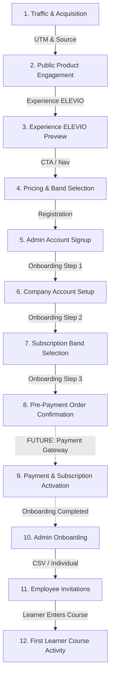

# ELEVIO Skills — Commercial Funnel Analytics & Conversion Measurement Standard

**Sprint 16.2 & 16.2A Standard Document**

---

## 1. Executive Summary & Objective

The ELEVIO Skills Commercial Funnel Analytics architecture provides a typed, privacy-conscious, vendor-neutral event measurement framework. It allows ELEVIO to evaluate anonymous acquisition channels, public product proof engagement, pricing interest, company account creation, and corporate activation without depending on any external payment provider or introducing tracking clutter.

---

## 2. Canonical Commercial Funnel Architecture

---

## 3. Canonical Event Taxonomy & Integrity Classification

Every event in ELEVIO Skills is strictly classified into one of four integrity tiers:
- **`IMPLEMENTED — authoritative`**: Proven by backend state confirmation or deterministic multi-condition gate.
- **`IMPLEMENTED — interaction signal`**: Reliable frontend user action or navigation event.
- **`RESERVED — future`**: Formally specified in schema types, but deliberately un-emitted pending backend / payment integration.
- **`NOT CURRENTLY RELIABLE`**: Not measurable without unacceptable performance trade-offs or missing telemetry.

| Funnel Stage | Event Name | Integrity Classification | Authoritative Trigger & Mechanics | Sample Properties |
| :--- | :--- | :--- | :--- | :--- |
| **Public Acquisition** | `public_page_view` | `IMPLEMENTED — interaction signal` | Public page load | `source`, `landingPath`, `currentPath` |
| **Public Acquisition** | `pricing_viewed` | `IMPLEMENTED — interaction signal` | Pricing page viewed | `source`, `landingPath`, `authenticatedState` |
| **Experience ELEVIO** | `experience_started` | `IMPLEMENTED — authoritative` | Screen 1 of Experience ELEVIO rendered (deduped per session) | `experienceStep: "screen_1_intro"`, `source: "experience"` |
| **Experience ELEVIO** | `experience_step_viewed` | `IMPLEMENTED — interaction signal` | Screen navigation in Experience ELEVIO | `experienceStep: "screen_2_situation"`, etc. |
| **Experience ELEVIO** | `experience_completed` | `IMPLEMENTED — authoritative` | **Strict Screen 8 Reached** (Screens 1–7 do NOT emit; deduped per session) | `experienceStep: "screen_8_commercial"` |
| **Experience ELEVIO** | `experience_pricing_clicked` | `IMPLEMENTED — interaction signal` | Clicked "Train Your Team — View Pricing" CTA | `experienceStep: "screen_8_commercial"` |
| **Experience ELEVIO** | `experience_catalogue_clicked`| `IMPLEMENTED — interaction signal` | Clicked "Explore All 136 Courses" CTA | `experienceStep: "screen_8_commercial"` |
| **Account Journey** | `signup_started` | `IMPLEMENTED — interaction signal` | Rendered `/sign-up` registration form; marks pending registration session flag | `source`, `authenticatedState: "anonymous"` |
| **Account Journey** | `signup_completed` | `IMPLEMENTED — authoritative` | **Deterministic Post-Registration**: Consumes pending registration session flag on `/onboarding` OR account created within 10 min with `hasCompany: false` (deduped per user) | `source: "onboarding"`, `authenticatedState: "authenticated"` |
| **Company Journey** | `company_setup_started` | `IMPLEMENTED — interaction signal` | Onboarding Step 1 rendered | `source: "onboarding"` |
| **Company Journey** | `company_created` | `IMPLEMENTED — authoritative` | **Server-Confirmed**: Successful HTTP 200 response from `/api/onboarding/company-details` | `companySizeBand`, `employeeCount`, `authenticatedState: "company_admin"` |
| **Subscription** | `subscription_band_viewed` | `IMPLEMENTED — interaction signal` | Subscription selection view rendered | `companySizeBand`, `billingCycle` |
| **Subscription** | `subscription_band_selected` | `IMPLEMENTED — interaction signal` | Band or billing toggle clicked/selected | `companySizeBand`, `billingCycle`, `employeeCount` |
| **Subscription Boundary**| `subscription_checkout_reached`| `IMPLEMENTED — authoritative` | **Pre-Payment Boundary**: Order confirmed on Step 3 prior to gateway payment | `companySizeBand`, `billingCycle`, `employeeCount` |
| **Onboarding** | `onboarding_started` | `IMPLEMENTED — authoritative` | Guided onboarding flow initialized for user | `source: "onboarding"` |
| **Onboarding** | `employee_import_started` | `IMPLEMENTED — interaction signal` | Drag-and-drop or file selected for CSV upload | `source: "company_employees"` |
| **Onboarding** | `employee_import_completed` | `IMPLEMENTED — authoritative` | **Server-Confirmed**: Bulk invitation batch processed successfully | `importSuccessCount`, `importSkippedCount` |
| **Team Management** | `employee_invitation_sent` | `IMPLEMENTED — interaction signal` | Single or bulk employee invitation dispatched | `employeeCount` |
| **Activation** | `first_employee_invited` | `IMPLEMENTED — authoritative` | Dispatched invite when `employees.length === 0` AND `invitations.length === 0` prior to action (deduped per company) | `employeeCount`, `authenticatedState: "company_admin"` |
| **Learner Progress** | `learner_course_started` | `IMPLEMENTED — interaction signal` | Enrolled employee loads active course player | `courseId`, `courseCode`, `authenticatedState: "employee"` |
| **Company Activation** | `first_learner_started_course`| `RESERVED — future` | Company-level first learner activation across entire tenant (requires server-side company activation webhook) | `courseId`, `courseCode` |
| **Payment Gateway** | `checkout_started` | `RESERVED — future` | Customer opens hosted payment gateway (MIPS / MCB MPGS) | N/A |
| **Payment Gateway** | `payment_succeeded` | `RESERVED — future` | Webhook confirms successful capture | N/A |
| **Payment Gateway** | `payment_failed` | `RESERVED — future` | Webhook or gateway reports payment rejection | N/A |
| **Subscription Lifecycle**| `subscription_activated` | `RESERVED — future` | Subscription status becomes `active` | N/A |

---

## 4. Specific Measurement Integrity Rules

### 1. `experience_completed` Semantic
- `experience_started` is emitted on Screen 1.
- `experience_step_viewed` is emitted on each screen transition (`screen_1_intro` .. `screen_8_commercial`).
- `experience_completed` is **ONLY** emitted when Screen 8 (*Commercial Summary & Action Screen*) is reached.
- Reaching Screen 6 (*Learner Completion Moment*) or Screen 7 (*Manager Reporting Preview*) does **NOT** emit `experience_completed`.
- Session deduplication (`elevio_exp_completed_session`) prevents duplicate milestones on re-render.

### 2. `signup_completed` Authoritative Trigger
- `signup_completed` is NOT emitted merely when an authenticated session visits `/onboarding`.
- A session flag (`elevio_pending_signup_reg`) is set when the user interacts with `/sign-up`.
- Upon arriving at `/onboarding`, the flag is verified and consumed, or fallback verification checks `user.createdAt < 10min` AND `hasCompany === false`.
- Returning admins and existing accounts visiting `/onboarding` never trigger `signup_completed`.

### 3. `first_employee_invited` Semantic
- Evaluates `(employees.length === 0 && invitations.length === 0)` prior to invitation dispatch.
- Emitted upon successful HTTP response for single or bulk invitations.
- Deduplication key (`elevio_first_employee_invited`) prevents re-emission on subsequent invites.

### 4. `first_learner_started_course` vs `learner_course_started`
- Client course-player loads cannot determine whether another learner in the company previously completed training without executing expensive tenant-wide aggregation queries on every lesson load.
- In accordance with performance and integrity standards, individual player loads emit `learner_course_started` (Interaction Signal).
- `first_learner_started_course` as a company-level activation milestone is classified as `RESERVED — future` to be triggered by server-side event listeners.

### 5. `employee_import_completed` Semantic
- Emitted **ONLY** upon receiving HTTP 200 from `/api/company/bulk-invitations/upload`.
- Failed uploads (network error, invalid CSV, HTTP 4xx/5xx) do NOT emit completion.
- Partial successes are represented accurately via `importSuccessCount` and `importSkippedCount` properties.

---

## 5. Prohibited PII Standard

The tracking runtime applies automated key scrubbing:
- ❌ NO employee/learner names (`name`, `firstName`, `lastName`, `fullName`)
- ❌ NO email addresses (`email`, `userEmail`)
- ❌ NO phone numbers (`phone`, `phoneNumber`)
- ❌ NO credentials or secrets (`password`, `token`, `secret`, `creditCard`, `cvv`)
- ❌ NO assessment inputs (`answers`, `assessmentAnswer`)
- ❌ NO certificate identifiers (`certificateId`)

---

## 6. Zero Payment Dependency Guarantee

In strict accordance with commercial readiness requirements:
- No payment SDKs (MIPS, MCB MPGS, Stripe) are installed.
- No checkout flows are initiated.
- No payment webhooks or subscription activations are performed.
- All payment lifecycle events are maintained strictly as `RESERVED — future`.
