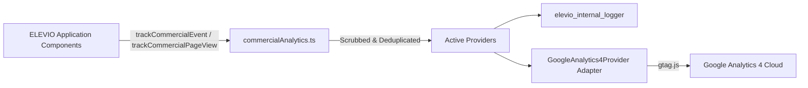

# ELEVIO Skills — Google Analytics 4 (GA4) Funnel Setup & Admin Configuration Standard

**Sprint 16.3 Standard Document**

---

## 1. Architectural Overview

ELEVIO Skills integrates Google Analytics 4 (GA4) strictly as a **Provider Adapter** within our vendor-neutral commercial analytics architecture. 



Application components never call `gtag()` directly. All events are emitted through `trackCommercialEvent(...)`, automatically protected by runtime PII scrubbing, deduplication guards, and safe error boundaries.

---

## 2. Canonical GA4 Funnel Specification

| Funnel Step | GA4 Event Name | Status | Authoritative Trigger | Sample GA4 Parameters |
| :---: | :--- | :---: | :--- | :--- |
| **Step 1** | `page_view` / `public_page_view` | **Active** | Public landing or SPA route change | `page_path`, `landing_path`, `source` |
| **Step 2** | `experience_started` | **Active** | Screen 1 of Experience ELEVIO rendered | `experience_step: "screen_1_intro"`, `source: "experience"` |
| **Step 3** | `experience_completed` | **Active** | Screen 8 reached in Experience ELEVIO | `experience_step: "screen_8_commercial"`, `source: "experience"` |
| **Step 4** | `pricing_viewed` | **Active** | Pricing page rendered | `source: "experience" / "navbar"`, `authenticated_state` |
| **Step 5** | `signup_started` | **Active** | `/sign-up` registration form mounted | `source`, `authenticated_state: "anonymous"` |
| **Step 6** | `signup_completed` | **Active** | **Post-Registration**: Arrives on `/onboarding` with new registration flag | `source: "onboarding"`, `authenticated_state: "authenticated"` |
| **Step 7** | `company_created` | **Active** | **Backend Confirmed**: HTTP 200 from `/api/onboarding/company-details` | `company_size_band`, `employee_count`, `authenticated_state: "company_admin"` |
| **Step 8** | `subscription_checkout_reached` | **Active** | **Pre-Payment Boundary**: Order review confirmed on Step 3 | `company_size_band`, `billing_cycle`, `employee_count` |
| *Step 9* | `checkout_started` | *Future* | Hosted payment gateway loaded | N/A (Reserved) |
| *Step 10* | `payment_succeeded` | *Future* | Gateway webhook confirms successful payment | N/A (Reserved) |
| *Step 11* | `subscription_activated` | *Future* | Subscription status updated to active | N/A (Reserved) |

---

## 3. GA4 Admin Configuration Guide

Follow these step-by-step instructions in the Google Analytics Admin console (`analytics.google.com`):

### Step A: Property & Data Stream Creation
1. Go to **Admin** $\rightarrow$ **Property** $\rightarrow$ **Create Property**.
2. Enter Property Name: `ELEVIO Skills — Production`.
3. Select Reporting Time Zone: `Mauritius (GMT+4)` and Currency: `Mauritian Rupee (MUR)`.
4. Choose **Web** as the platform.
5. Set Stream URL: `https://app.elevio.mu` (or production domain) and Stream Name: `ELEVIO Web App`.
6. Copy the resulting **Measurement ID** (format: `G-XXXXXXXXXX`).

### Step B: Environment Configuration
1. In the hosting deployment dashboard (e.g. Render / Vercel), add the environment variable:
   ```env
   VITE_GA_MEASUREMENT_ID=G-XXXXXXXXXX
   ```
2. If `VITE_GA_MEASUREMENT_ID` is omitted or empty, the provider adapter fails closed in safe no-op mode without throwing any runtime errors or polluting console logs.

### Step C: Register Custom Dimensions
In GA4 Admin $\rightarrow$ **Custom definitions** $\rightarrow$ **Create custom dimension**, register the following event-scoped dimensions:

| Dimension Name | Scope | Event Parameter | Description |
| :--- | :--- | :--- | :--- |
| **Company Size Band** | Event | `company_size_band` | Approved band (`UP_TO_25`, `FROM_26_TO_50`, etc.) |
| **Billing Cycle** | Event | `billing_cycle` | `MONTHLY` or `ANNUAL` |
| **Experience Step** | Event | `experience_step` | Step key (`screen_1_intro` .. `screen_8_commercial`) |
| **Course Code** | Event | `course_code` | Course code (e.g. `ELH-01`, `ELH-23`) |
| **Internal Source** | Event | `source` | Journey context (`experience`, `navbar`, `homepage`) |
| **Landing Path** | Event | `landing_path` | Initial entry URL path |
| **Authenticated State**| Event | `authenticated_state` | `anonymous`, `authenticated`, `company_admin` |

### Step D: Mark Key Events (Conversions)
In GA4 Admin $\rightarrow$ **Key Events** (formerly Conversions) $\rightarrow$ **New key event**, mark the following primary milestone events as key events:
- `experience_completed`
- `signup_completed`
- `company_created`
- `subscription_checkout_reached`
- *(Future: `payment_succeeded`)*

> [!IMPORTANT]
> **Do NOT Mark Interaction Events as Key Events**: Events such as `experience_step_viewed`, `pricing_viewed`, and `subscription_band_selected` are funnel progression signals and must NOT be marked as key events or conversion goals.

### Step E: Create the Funnel Exploration Report
1. In GA4, navigate to **Explore** $\rightarrow$ **Funnel exploration**.
2. Set Technique: **Funnel exploration**.
3. Add Steps in sequence:
   - **Step 1 — Landing**: `event_name = page_view`
   - **Step 2 — Experience Start**: `event_name = experience_started`
   - **Step 3 — Experience Complete**: `event_name = experience_completed`
   - **Step 4 — View Pricing**: `event_name = pricing_viewed`
   - **Step 5 — Start Signup**: `event_name = signup_started`
   - **Step 6 — Complete Signup**: `event_name = signup_completed`
   - **Step 7 — Create Company**: `event_name = company_created`
   - **Step 8 — Reach Checkout**: `event_name = subscription_checkout_reached`

### Step F: SPA Page View Deduplication (Enhanced Measurement)
Because ELEVIO's SPA already emits deterministic manual `page_view` events via `trackCommercialPageView` on Wouter client-side route changes, GA4's default automatic browser history listener will produce double counts if left active.
1. In GA4 Admin $\rightarrow$ **Data Streams** $\rightarrow$ Click on the Web Stream.
2. In the **Enhanced measurement** section, click the **Settings (gear) icon**.
3. Expand **Page views** and click **Show advanced settings**.
4. **Uncheck**: `"Page changes based on browser history events"`.
5. Click **Save**.

---

## 4. Development & Verification Workflow

1. **Browser Diagnostics & Live Inspection**:
   - To inspect analytics status, provider readiness, and dataLayer queue directly in the browser console, run:
     ```js
     window.__ELEVIO_ANALYTICS_DIAGNOSTICS__();
     ```
   - To enable verbose real-time console streaming of all accepted, scrubbed, and dispatched GA4 events during test sessions:
     ```js
     window.__ELEVIO_ANALYTICS_DEBUG__ = true;
     ```
   - Or append `?debug_mode=true` to any URL (e.g., `https://app.elevio.mu/experience?debug_mode=true`).

2. **GA4 Realtime & DebugView**:
   - In normal production, `debug_mode` is omitted so normal visitors do not flood DebugView.
   - When `debug_mode` is explicitly activated during testing, events route immediately into GA4 Admin $\rightarrow$ **DebugView**.
   - In GA4 **Reports** $\rightarrow$ **Realtime**, events increment under **Event count by Event name** (`experience_started`, `experience_step_viewed`, `experience_completed`, `pricing_viewed`, etc.) once analytics consent is granted.

---

## 5. Privacy, PII Protection & Google Consent Mode v2

- **Automated PII Filter**: All properties pass through `scrubProhibitedProperties` before reaching GA4. GA4 **never** receives employee names, emails, phone numbers, passwords, tokens, or assessment answers.
- **No User-ID PII**: Clerk user IDs and email addresses are NOT used as GA4 `user_id`. Measurement is anonymous and session-oriented.
- **Google Consent Mode v2 Defaults**:
  - `analytics_storage`: Defaults to `denied` unless a legitimate consent signal (`localStorage.elevio_consent_analytics === 'granted'` or `window.__ELEVIO_ANALYTICS_CONSENT__ === true`) is present.
  - `ad_storage`, `ad_user_data`, `ad_personalization`: Unconditionally `denied` (zero marketing/advertising tracking).
- **Consent Lifecycle**:
  - Without explicit consent: GA4 operates in cookieless Consent Mode (no `_ga` cookie written).
  - When consent is granted (via user preference or `getOrCreateGA4Provider().setConsent(true)`): `gtag('consent', 'update', { analytics_storage: 'granted' })` is sent, unlocking cookie-based measurement and Realtime event counting.
  - When consent is revoked: `getOrCreateGA4Provider().setConsent(false)` sends `analytics_storage: 'denied'`, suppressing subsequent dispatches.
  - Analytics failure or script blocking (via uBlock/AdBlock) never disrupts product functionality or page routing.

---

## 6. Future Google Ads Conversion Integration

When Google Ads acquisition campaigns are launched in the future:
1. Link Google Ads to this GA4 property via GA4 Admin $\rightarrow$ **Google Ads Links**.
2. Import the following key events as primary bidding conversions:
   - `signup_completed`
   - `company_created`
   - *(Future: `payment_succeeded`)*
3. Maintain `experience_completed` as a secondary (observational) conversion to optimize top-of-funnel traffic quality.


